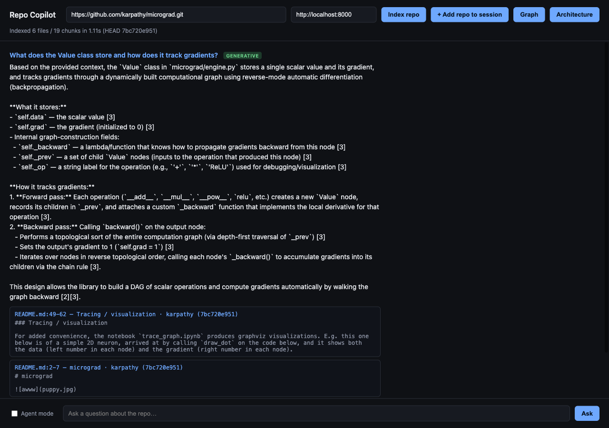
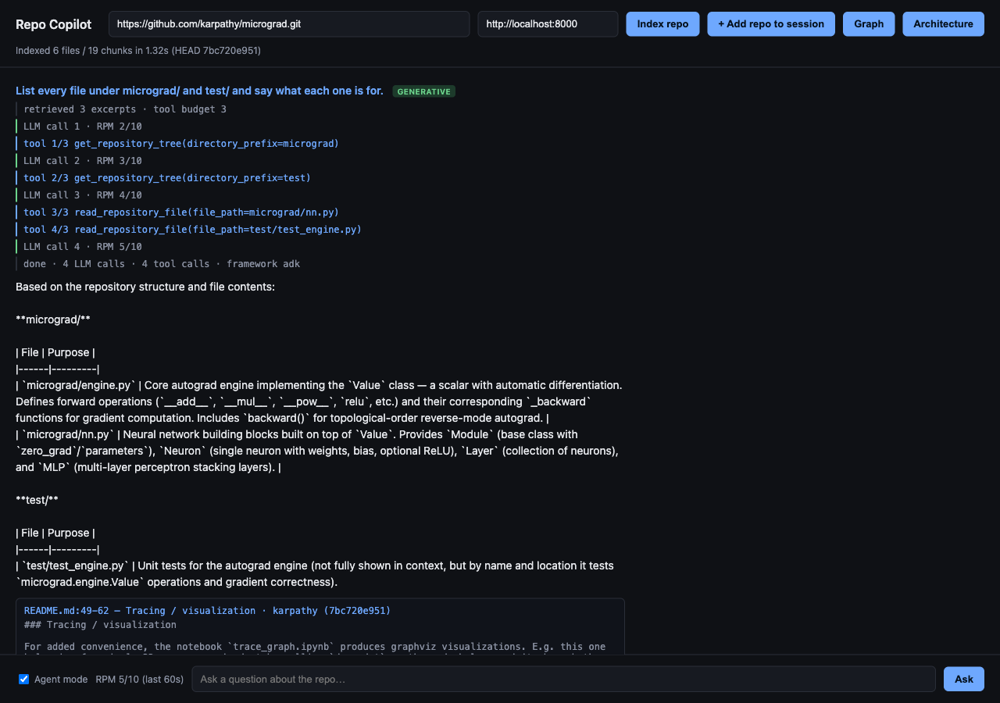
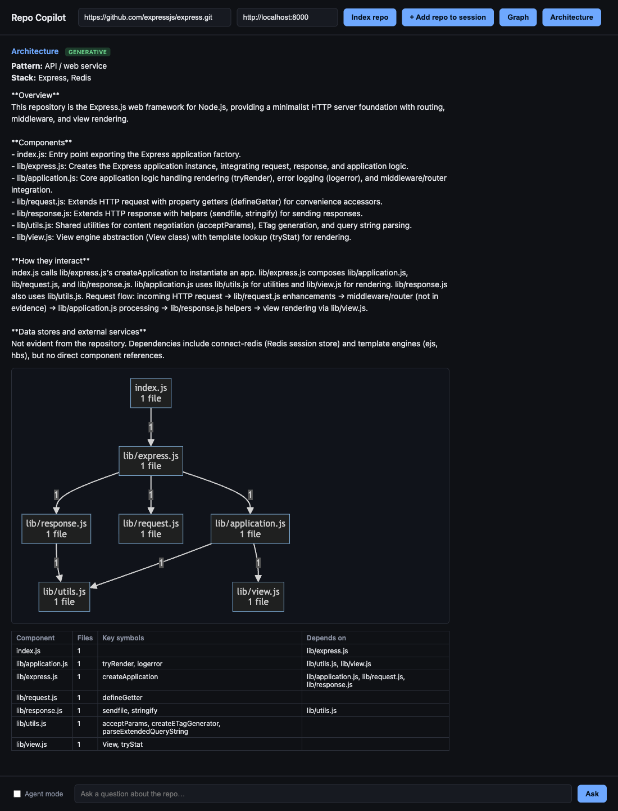

# GitHub Repository Copilot — Agentic Repository Intelligence Platform

Chat with a GitHub repository: index it, then ask questions about what it does, how
it's architected, how to run it, and how specific code works — with grounded citations
on every answer. Built incrementally on a working hybrid-RAG core, now wrapped in a
real LangGraph workflow and a real Google ADK tool-calling agent, backed by NVIDIA AI Endpoints (no self-hosted model) with a pluggable multi-provider fallback.

**How to read this README:** every claim below falls into one of three buckets, and
I've kept them visually distinct on purpose rather than blur them into one "it works"
narrative:
- ✅ **Verified** — built and actually run in this session, against a real cloned
  repository or a real local service (MLflow, a live FastAPI server), with the
  command/output to prove it in the PR/commit history.
- 🔧 **Real but unexecuted** — real code/config that was written and reviewed, but
  needs infrastructure this sandbox doesn't have (a Docker daemon, GCP credentials,
  a live NVIDIA API key) to actually run. Not fake, not tested end-to-end.
- 📋 **Documented only** — instructions/templates, not code that runs by itself.

---

## Screenshots

Captured from the real frontend (`frontend/index.html`) against a local backend on
2026-10-25, with a live NVIDIA key, `LLM_MODEL`/`NVIDIA_MODEL` set to
`nvidia/nemotron-3-ultra-550b-a55b` and `NVIDIA_RPM_LIMIT=10`. Nothing is mocked or
edited. The page shows model output as plain text, so markdown (bold, tables) appears
as raw characters.

**1. A streamed, cited answer** (`karpathy/micrograd`). The answer arrives as it is generated, with the
retrieved excerpts as citations (file, line range, last commit author and SHA) and the
provider line at the bottom reporting `status: success`.



**2. Agent mode, with the step trace.** For "List every file under `micrograd/` and `test/`…" the
agent takes 4 model calls and 4 tool requests, each shown as it happens with the running
requests-per-minute count. The 4th tool request (`tool 4/3`) was refused by the 3-call
budget, which is why the count is above the maximum. The badge is `generative`.



**3. Architecture analysis** (`expressjs/express`). The explanation is written by the LLM from the
extracted evidence; the diagram and the component table come straight from the repo's
imports. Redis appears in the stack because `connect-redis` is in Express's dependency
list, not because the core uses it.



---

## What's actually new here vs. the existing hybrid-RAG core

The repository already had a solid, tested foundation: repo cloning, tree-sitter +
Python AST + Markdown chunking, BM25 + TF-IDF/dense hybrid search with Qdrant, RRF,
reranking, citations, GitHub issues/PRs/commits, incremental indexing, SQLite session
persistence, and RAGAS/DeepEval hooks. None of that was rewritten. What's new in this
pass:

| Layer | What it is | Status |
|---|---|---|
| `app/llm_gateway/` | Abstract `LLMProvider` interface + `ChatNVIDIA`-backed implementation | ✅ constructs correctly, raises clean errors without a key |
| `app/langchain_rag/` | `Chunk` → LangChain `Document` conversion + `HybridRepoRetriever(BaseRetriever)` | ✅ verified against a real repo via `.invoke()` |
| `app/agent/workflow.py` | Real LangGraph `StateGraph`: intent → retrieve → validate → generate → citations, bounded retry | ✅ verified end-to-end, including retry-loop termination on an empty index |
| `app/agent/tools.py` | 5 typed repository tools (search, read file, tree, find symbol, dependencies) | ✅ all 5 tested, including path-traversal blocking |
| `app/agent/repository_agent.py` | Google ADK `Agent` with tool-calling, NVIDIA model via LiteLLM | ✅ run live against NVIDIA (`nemotron-3-ultra-550b-a55b`): real tool calls, streamed step by step — see [Agent cost controls](#agent-cost-controls-and-nvidia-rate-limits) |
| `app/observability/mlflow_tracking.py` | Per-query MLflow run logging | ✅ verified — queried the SQLite store afterward and confirmed real metrics |
| `app/observability/langsmith_setup.py` | LangSmith status check (tracing itself is env-var-activated) | ✅ (there's little to test — it's a status read) |
| `POST /api/chat` | ADK-first, automatic fallback to the direct LangGraph workflow | ✅ hit through a live server, confirmed correct fallback behavior |
| `GET /api/sessions/{id}/summary`, `GET /api/repository/summary` | Repository Summary Agent | ✅ hit through a live server, grounded README/manifest/entrypoint evidence |
| `GET /api/ready` | Readiness probe | ✅ |
| `Dockerfile`, `docker-compose.yml`, `.github/workflows/ci-cd.yml` | Containerization + CI | 🔧 written, YAML/syntax-validated, not build/run-tested |
| `docs/DEPLOYMENT.md` | Cloud Run deployment | 📋 real `gcloud` commands, unexecuted |

### Added since then

| Change | What it does | Status |
|---|---|---|
| Streaming answers | `POST /api/query` with `"stream": true` returns server-sent events: `sources`, one `token` per piece, then `done` | ✅ live against NVIDIA; test in `test_api.py` |
| Session restore | A session survives a server restart: its repo URLs and turns are stored, and the index is rebuilt under the same `session_id` on the next request, so follow-ups keep their history and you don't re-index by hand | ✅ test in `test_api.py` |
| Agent cost controls | Retrieved excerpts go into the agent's prompt, tool calls are capped per answer, and every NVIDIA call goes through one shared rate limiter | ✅ measured, see [below](#agent-cost-controls-and-nvidia-rate-limits) |
| Live agent trace | `POST /api/chat` with `"stream": true` emits every LLM call (with the live requests-per-minute count) and every tool call; the page shows them under an **Agent mode** checkbox | ✅ driven through a real browser |
| Architecture analysis | Components, the dependencies between them, entry points, tech stack, a Mermaid diagram and a written explanation, derived from the repo's own imports and manifests, for any supported language | ✅ run on Python, JS, Go and Java repos, see [below](#architecture-analysis) |
| Chunker fix | The tree-sitter chunker used to drop top-level code (`require(...)`, imports, constants) for JS/TS/Go/Java/etc.; it now keeps it as module chunks, as the Python chunker always did | ✅ test in `test_retrieval.py` |
| More file types | Indexing now also reads dependency manifests (`requirements.txt`, `pyproject.toml`, `go.mod`, `Cargo.toml`, `pom.xml`, `build.gradle`, `Gemfile`) and `.rb`, `.php`, `.cs`, `.kt`, `.swift` files | ✅ |

---

## Architecture

```
Frontend (static, unchanged)
        │
        ▼
     FastAPI  ──────────────────────────────────────────┐
        │                                                │
        ▼                                                │
  Google ADK Repository Agent  (AGENT_FRAMEWORK=adk)      │ AGENT_FRAMEWORK=direct
  - tool-calling: search_repository, read_repository_file,│ or ADK unavailable/
    get_repository_tree, find_symbol, get_dependencies    │ construction failed
        │                                                │
        ▼                                                ▼
              LangGraph Workflow (app/agent/workflow.py)
   intent_detection → retrieve → validate_context ⇄ (bounded retry)
                                        │
                                        ▼
                                    generate → build_citations
        │
        ▼
   LangChain Retrieval Layer (app/langchain_rag/)
   HybridRepoRetriever(BaseRetriever) → Document[]
        │
        ▼
   Hybrid Retrieval (app/search.py — unchanged, pre-existing)
   BM25  +  Dense (Qdrant)  →  weighted RRF  →  dedupe  →  rerank
        │
        ▼
   LLM: ChatNVIDIA (app/llm_gateway/) or the existing multi-provider
   gateway (app/llm.py: Anthropic/OpenAI/NVIDIA-compat/DeepSeek),
   with extractive fallback if nothing is configured
        │
        ▼
   Grounded Answer + Citations (file:start-end, commit SHA, author)
```

`/api/chat` is the agentic entry point described above. `/api/query` calls the
retrieval+generation path directly without going through LangGraph, for callers
that don't need agentic routing. It's the *only* retrieval-QA HTTP endpoint —
the earlier separate `/api/query/stream` duplicated the same retrieval/prompt/provider
logic and had drifted out of sync, so streaming is now a flag (`"stream": true`) on
`/api/query` itself, which keeps one pipeline. `/api/query` is also plan-aware: `planner.plan(question)` actively
shapes retrieval (source-boosted ranking, plan-aware query expansion and reranking)
instead of only being reported back for debugging — see [API reference](#api-reference).

---

## Technology stack

| Concern | Choice |
|---|---|
| Backend | Python 3.12, FastAPI, Pydantic v2 |
| Agent framework | Google ADK (`google-adk[extensions]`) |
| Orchestration | LangGraph (`StateGraph`) |
| Retrieval abstraction | LangChain (`Document`, `BaseRetriever`) |
| LLM (primary, agentic path) | NVIDIA AI Endpoints via `ChatNVIDIA` — no self-hosted model |
| LLM (fallback path, pre-existing) | Anthropic, OpenAI, NVIDIA (OpenAI-compatible), DeepSeek |
| Hybrid retrieval | BM25 (`rank-bm25`) + dense (TF-IDF or OpenAI embeddings) via Qdrant, weighted RRF |
| Reranking | Lexical (default) or Cohere cross-encoder |
| Chunking | Python AST, tree-sitter (Java/Go/Rust/TS/JS/C/C++), Markdown headings, generic fallback |
| Vector store | Qdrant — embedded in-memory/on-disk by default, or a real server (`qdrant_server`) |
| Experiment tracking | MLflow (local SQLite by default) |
| Tracing | LangSmith (optional, env-var activated) |
| Evaluation | Recall@K/MRR/nDCG (built-in), RAGAS, DeepEval |
| Session persistence | SQLite (adapter-shaped for Redis/Postgres later) |
| Containerization | Docker, docker-compose |
| CI/CD | GitHub Actions |
| Cloud target | Google Cloud Run (LLM stays external) |

---

## Setup

```bash
cd backend
pip install -r requirements.txt
cp .env.example .env
uvicorn app.main:app --reload --port 8000
```

Verified fresh: `pip install -r requirements.txt` into a **clean, empty virtualenv**
(not just this already-loaded sandbox) produced a fully working app — see
[Testing](#testing) below for the current pass/fail count, which has changed since
that clean-venv run and hasn't been re-verified there yet.

With no `.env` filled in at all, the app still answers questions: retrieval runs on
BM25 + TF-IDF (no key needed), `/api/chat` automatically falls back from
`AGENT_FRAMEWORK=adk` to the direct LangGraph workflow (since ADK's model needs a
`NVIDIA_NIM_API_KEY` to plan tool calls), and answers come back in extractive mode —
labeled as such, not silently degraded.

Serve the frontend and open it (the Architecture diagram loads Mermaid from a CDN, so
open it over HTTP rather than as a `file://` page):

```bash
cd frontend && python3 -m http.server 8080     # then open http://localhost:8080/index.html
```

The page's second box is the API address (default `http://localhost:8000`). Index a
repo, then ask questions. Tick **Agent mode** to use the tool-calling agent and watch
each LLM call and tool call appear live; leave it off for the plain streamed answer.
**Architecture** shows the architecture analysis for the indexed repo.

### Configuring providers

See `backend/.env.example` for the full list. The two provider paths that matter most:

```bash
# Agentic path (ADK + ChatNVIDIA) — needs this to do real tool-calling:
NVIDIA_NIM_API_KEY=nvapi-...
LLM_MODEL=nvidia/nemotron-3-ultra-550b-a55b
AGENT_FRAMEWORK=adk

# Fallback path (pre-existing, works today, either provider set):
LLM_PROVIDER=anthropic   # or openai | nvidia | deepseek
ANTHROPIC_API_KEY=sk-ant-...
```

Both can be set at once — `/api/chat` tries ADK first and falls back automatically;
`/api/query` always uses the fallback path.

Two things that trip people up with NVIDIA:

- **The key variable is `NVIDIA_NIM_API_KEY`.** That is the only name the code reads, for
  both the agent and `LLM_PROVIDER=nvidia`. An older `NVIDIA_API_KEY` is ignored.
- **Set `NVIDIA_MODEL` to a model that is still served.** With `LLM_PROVIDER=nvidia` the
  code's built-in default (`meta/llama-3.1-70b-instruct`) now answers HTTP 410 (retired),
  and every answer silently falls back to extractive mode. `nvidia/nemotron-3-ultra-550b-a55b`
  answered with the key used for testing; list what your key can call with
  `GET https://integrate.api.nvidia.com/v1/models`, and confirm a model answers before
  relying on it (some listed models returned 404 or 410 for the same key).

---

## API reference

All pre-existing endpoints from the hybrid-RAG core are unchanged (indexing,
multi-repo sessions, incremental reindex, graph, architecture, GitHub integration,
code execution, evaluation — see inline FastAPI docs at `/docs` once running). New
in this pass:

```
POST /api/query
  { "session_id": "...", "question": "What does this repository do?", "top_k": 5 }
  → { answer, citations[], mode, retrieved_chunks, llm_debug, plan_sources[],
      retrieval_strategy, boosted_files[] }

  Retrieval is plan-aware: planner.plan(question) actively boosts fused
  BM25+dense scores toward the files that intent needs (README/docs for a
  repository-summary question, architecture docs + entrypoints for an
  architecture question, Dockerfile/deploy docs for a deployment question,
  etc.) instead of only reporting plan_sources for debugging. Boosting never
  hard-filters — a plan-preferred source with no matches falls back to plain
  hybrid search rather than returning empty results. retrieval_strategy and
  boosted_files report which files, if any, were actually boosted for this
  query. This is the only retrieval-QA endpoint.

  With "stream": true the response is text/event-stream, each event one line
  `data: {json}` followed by a blank line:
    {"type": "sources", "citations": [...], "plan_sources": [...], ...}   once, first
    {"type": "token", "text": "..."}                                       per piece of answer
    {"type": "done", "answer": "...", "mode": "...", "llm_debug": {...}}   once, last
  The turn is saved to the session after the stream ends. If the LLM fails before
  the first token, the answer comes back extractive, as in the non-streamed path.
  A session_id from before a server restart still works: the index is rebuilt on
  the first request (a few seconds for a small repo) and the conversation reloaded.

POST /api/chat
  { "session_id": "...", "message": "How does auth work?", "top_k": 5, "stream": false }
  → { answer, citations[], mode, intent, agent_framework, tool_calls[], retry_count }

  Tries the Google ADK Repository Agent (real tool-calling) if AGENT_FRAMEWORK=adk
  and NVIDIA_NIM_API_KEY is set; otherwise (or on any ADK construction failure) falls
  back to the LangGraph workflow directly. agent_framework in the response tells
  you which path actually answered.

  With "stream": true (ADK path only; with AGENT_FRAMEWORK=direct it is ignored and
  you get the normal JSON response) the events are:
    {"type": "sources", "citations": [...], "tool_calls_max": 3, "rpm_limit": 10}
    {"type": "llm_turn", "n": 1, "rpm_used": 4, "rpm_limit": 10}      one per model request
    {"type": "tool_call", "n": 1, "name": "search_repository", "args": {...}}
    {"type": "fallback", "reason": "..."}     only if ADK failed; answered by the workflow
    {"type": "token", "text": "..."}          the whole answer, as one event
    {"type": "done", "answer", "mode", "agent_framework", "tool_calls", "llm_turns", "llm_debug"}
  Tool calls the budget refuses still appear (so you can see n above the maximum).
  The streamed path is not logged to MLflow; the non-streamed /api/chat is.

GET /api/sessions/{session_id}/architecture?explain=true
  → { likely_architecture_patterns[], detected_frameworks_and_infra[], components[],
      entry_points[], dependencies[], external_imports[], compose_services[],
      top_level{}, diagram, explanation, explanation_mode, signal_strength{} }

  See [Architecture analysis](#architecture-analysis). explain=false skips the LLM call
  and returns the plain-facts summary instead (explanation_mode "extractive").

GET /api/sessions/{session_id}/summary
GET /api/repository/summary?session_id=...        (alias matching the spec's literal path)
  → { repo_urls[], summary, citations[], architecture_patterns[], detected_frameworks[], mode }

  Repository Summary Agent: gathers README/manifest/Dockerfile/entrypoint evidence
  by filename + a few targeted searches, combines with the existing heuristic
  architecture detector, and generates a structured summary (Purpose, Main
  Functionality, Architecture, Important Components, Technology Stack, Entry Point,
  APIs, Data Stores, External Services, How Components Interact) — grounded in the
  gathered evidence, explicitly saying "Not evident from the indexed repository
  content" for anything it can't support.

GET /api/health
  → now also reports agent_framework, adk_configured, mlflow_enabled, langsmith status

GET /api/ready
  → readiness probe: can the process actually construct its retrieval dependencies
```

---

## Agent cost controls and NVIDIA rate limits

Every model turn the ADK agent takes is one request to NVIDIA, and an unconstrained
agent takes a lot of them. Three controls (all in `app/agent/repository_agent.py` and
`app/rate_limit.py`):

- **Context first.** `/api/chat` retrieves the top excerpts and puts them in the agent's
  prompt, so many questions need no tool call at all.
- **Tool budget.** `AGENT_MAX_TOOL_CALLS` (default 3) caps tool calls per answer. Once it
  is spent the tools are no longer offered to the model, so it has to write the answer.
- **One shared rate limiter.** `NVIDIA_RPM_LIMIT` caps requests per 60 seconds and spaces
  them evenly. It covers every NVIDIA call (the agent's turns, query rewrites, answers).
  `NVIDIA_MAX_RETRIES` (default 5) retries a 429 with backoff inside LiteLLM.

Measured on `karpathy/micrograd` (ADK path, tool calls per answer and total time):

| Question | Original agent, no controls | + budget, limiter, excerpts | + file-read fix, full excerpts (now) |
|---|---|---|---|
| How `backward()` orders the graph | 37 calls, 321 s | 4 calls, 57 s | 0 calls, 22 s |
| "Where is `tanh` implemented" | 29 calls, 261 s | 4 calls, 70 s | not rerun, see below |
| How `MLP` collects parameters | 4 calls, 32 s | 0 calls, 19 s | 0 calls, 51 s |
| Where `relu` is implemented (replaced the tanh question) | n/a | n/a | 0 calls, 14 s |

Read this table with three caveats:

- **The tanh question has no answer in this repo.** micrograd has no `tanh` (it has `relu`),
  so the agent searched for something that isn't there and used its whole budget. It is a
  poor test question, and I replaced it with the `relu` one.
- **A tool bug inflated the first two columns.** `read_repository_file` required an exact
  `repo_url`, and the model usually wrote it without `.git` or left it out, so those reads
  failed and the agent kept trying. The tool now takes `repo_url` as optional, matches it
  ignoring `.git`, a trailing `/` and case, and the excerpts passed to the agent are no
  longer cut at 1,500 characters (now 4,000). The first two columns were measured before
  that fix, so they include those wasted retries. I didn't log the tool results of those
  runs, so I can't say how many of the 37 and 29 calls were failures.
- **Times are noisy.** The same MLP question went from 19 s to 51 s between runs with no code
  change; most of that is NVIDIA response time and pacing, one run per cell.

With the fixes, questions the retrieved excerpts can answer take 1 model call and 0 tool
calls. A question retrieval can't answer by itself ("list every file under `micrograd/`
and `test/`") still uses the tools: 3–4 model calls, with `get_repository_tree` and
`read_repository_file` calls that now succeed (screenshot 2). All answers above were
generative with no 429s. "4 calls" in the middle column is 3 that ran plus 1 the budget
refused.

The final answer now skips the model's reasoning parts (ADK marks them as `thought`); before
that, some answers started with a few sentences of the model's planning text.

**The free-tier limit on the key used for testing was much lower than 40 requests per
minute.** Probing the endpoint directly with tiny requests: spaced 1.5 s apart (40/min),
only 3 of 12 succeeded and the rest were HTTP 429; spaced 6 s apart (10/min), 5 of 6
succeeded. That is one key on one afternoon, so treat it as indicative, not as NVIDIA's
documented limit. The practical advice is to set `NVIDIA_RPM_LIMIT=10` and raise it only
if you see no 429s. The default in code is 40, and at 10 each model request waits
about 6 s, so a 5-turn agent answer cannot finish in under about 30 s.

Typical latency for one response with that setting (micrograd, one key; a handful of runs,
so indicative only):

| Path | Question the excerpts answer | Question needing file reads | LLM calls |
|---|---|---|---|
| ADK agent (`AGENT_FRAMEWORK=adk`) | 14–51 s, 0 tool calls | about 30 s, 3–4 tool calls (seen in the browser, not stopwatch-timed) | 1 per turn |
| LangGraph workflow (`AGENT_FRAMEWORK=direct`) | 31 s | 19 s | 2 |

The workflow row was measured before the tool fix, which doesn't touch that path. The two
rows used different questions, so don't read them as a like-for-like race.

The workflow's second run of the deep question took 11 s but came back extractive (the
LLM call failed and it fell back to excerpts; the cause wasn't captured), so it is not
a generation time. The workflow's 2 calls were the query rewrite and the answer; the
rewrite only happens when `ENABLE_MULTI_QUERY=true` (it was on in the `.env` used for these
runs; it is off in `.env.example` and by default), so with it off the workflow makes 1
call. With the fixes above, the agent also makes 1 call when the excerpts are enough, so
neither path is clearly faster for those questions. The agent's extra cost shows up only
when it has to open files or list directories.

---

## Architecture analysis

`GET /api/sessions/{id}/architecture` (the **Architecture** button) explains any indexed
repository from its own files instead of matching keywords. `app/architecture_detect.py`:

- **Components.** Files are grouped into components: one per file for small repos,
  otherwise by directory, descending into a dominant directory (`src/`, `backend/app/`,
  deep Java packages) while keeping its siblings as their own components. Tests, examples,
  docs, benchmarks and fixtures are left out.
- **Dependencies between components** from real import statements, read for Python,
  JavaScript/TypeScript, Go, Java/Kotlin, Rust, C/C++, Ruby, PHP, C# and Swift. An import
  is matched to a file in the repo only when the match is unique; otherwise it is dropped.
- **Tech stack** from dependency manifests and from imports that point outside the repo,
  not from words in the README or comments. Docker, Compose, Terraform and SQL come from
  the files that exist.
- **Entry points** from `main` functions, `uvicorn.run`, `listen(...)`, Spring Boot
  annotations and the Dockerfile's `CMD`/`ENTRYPOINT`.
- **Pattern labels**: Library / package, API / web service, Layered, Hexagonal,
  Event-driven, Monorepo, Multi-service deployment, or "Modular codebase".
- **Diagram.** A Mermaid flowchart built directly from the components and edges, so it is
  always valid and never invented. **Explanation.** One LLM call that is shown only that
  evidence plus the README excerpt and told to say "Not evident" rather than guess. With
  no LLM configured, or `explain=false`, you get the same facts as plain text.

Results on real repos: micrograd → Library, `nn.py` depends on `engine.py`, no stack;
Express → `index.js → lib/express.js → application/request/response → utils/view`;
Spring PetClinic → `owner` and `vet` depend on `model`, Spring + MySQL/PostgreSQL;
this repo → FastAPI, LangGraph, Qdrant, MLflow, Docker, entry point from the Dockerfile.

Limits: only languages the indexer reads are analysed; a package imported by its repo-root
name (such as a single-package Go library) shows no internal edges; `pyproject.toml`
dependency parsing is approximate; a dependency listed only for examples or dev tooling
(Express lists `connect-redis`) still appears in the stack.

---

## Testing

```bash
cd backend
pytest tests/ -v
```

42 tests, covering:
- Python AST + multi-file chunking (`test_retrieval.py`)
- Hybrid search correctness and dedup (`test_retrieval.py`)
- Plan-aware retrieval (`test_plan_aware_retrieval.py`): a repository-summary question
  ranks README before implementation files, an architecture question ranks
  architecture docs first, a deployment question surfaces the Dockerfile/deploy docs,
  `search()` stays backward-compatible with no plan passed, and a plan whose preferred
  source has no matching files falls back to plain hybrid search instead of returning
  nothing
- The LangChain `HybridRepoRetriever` wrapper, including metadata completeness
- Intent classification against the spec's example questions (`test_langgraph_workflow.py`)
- The LangGraph workflow's citations and — importantly — that its retry loop actually
  **terminates** on a genuinely empty index instead of looping forever
- All 5 ADK tools, including a real path-traversal-blocking check
- ADK's own graceful failure (`ADKAgentUnavailable`) with no `NVIDIA_NIM_API_KEY`
- FastAPI endpoints end-to-end via `TestClient`: `/api/chat`'s automatic ADK→direct
  fallback, the summary endpoint (both paths), health/ready, and a 404 on an unknown
  session

- Streaming `/api/query` (event order, tokens add up to the final answer), and a session
  being restored after a restart (`test_api.py`)
- The tool-call budget and the file-read tool accepting a repo URL with or without `.git`,
  or none at all (`test_adk_tools.py`), and the architecture analysis on synthetic
  JavaScript, Python and Go repos plus a check that mentions in docs/tests don't count
  as stack (`test_architecture.py`)
- The tree-sitter chunker keeping top-level `require(...)` lines (`test_retrieval.py`)

Last full run on a machine with `NVIDIA_NIM_API_KEY` set in `.env`: **41 passed, 1 failed**.
The failing test is `test_chat_endpoint_falls_back_to_direct_workflow_without_nvidia_key`:
it expects the no-key fallback, but a key in `.env` is loaded by `python-dotenv`, so
`/api/chat` correctly takes the ADK path instead. Run alone with the key unset
(`NVIDIA_NIM_API_KEY= pytest tests/test_api.py -k falls_back`) it passes. That is the
expected state in CI, where there is no key, but I only ran that one test with the key
unset, not the whole suite. The earlier 2-failure note in this README is out of date.

CI (`.github/workflows/ci-cd.yml`) runs the same `pytest tests/` on every PR — 🔧 written
and internally consistent with the local commands above, not run on a real GitHub
Actions runner from this sandbox.

---

## Evaluation

Unchanged from the existing core, still real:

```bash
POST /api/eval/run            # Recall@K, MRR, nDCG against a labeled query set you provide
POST /api/eval/generate_benchmark   # needs an LLM provider
POST /api/eval/judge          # LLM-as-judge, needs an LLM provider
POST /api/eval/deepeval        # needs OPENAI_API_KEY + `pip install -r requirements-eval.txt`
POST /api/eval/ragas           # same; see that file for a known ragas/langchain-community
                                # dependency-pinning issue and its workaround
```

Evaluation is never run automatically per-query — only on these explicit calls, per the
spec's own "do not run RAGAS/DeepEval on every query" requirement. MLflow tracking
(separate from RAGAS/DeepEval) *does* run on every `/api/chat` call, logging latency,
retrieved-chunk count, mode, and intent — that's lightweight enough to always run, and
is what makes the "Model Evaluation" MLflow requirement real rather than a manual-only
afterthought:

```bash
mlflow ui --backend-store-uri sqlite:///./backend/mlflow.db
```

---

## Docker

```bash
cp backend/.env.example backend/.env   # fill in a provider
docker compose up --build
```

🔧 **Written, `docker-compose.yml` YAML-validated, `Dockerfile` hand-reviewed against
the same dependency list that passed the clean-venv test above — not actually built or
run**, since this sandbox has no Docker daemon. Brings up `qdrant`, `mlflow`, and the
FastAPI `backend` together; the backend is configured via env vars to point at the
sibling `qdrant`/`mlflow` containers instead of its embedded/local defaults. Non-root
user, healthchecks, and a `.dockerignore` that keeps `.env`/databases/caches out of the
image are all in place — standard hardening, not exotic.

---

## Cloud deployment (Google Cloud Run)

📋 See [`docs/DEPLOYMENT.md`](./docs/DEPLOYMENT.md) — real, reviewed `gcloud` commands,
explicitly marked as unexecuted (no GCP credentials or network access to any
`*.googleapis.com` endpoint in the sandbox this was built in). The LLM stays external
throughout (NVIDIA AI Endpoints or the existing provider gateway) — Cloud Run only ever
runs the FastAPI container, never a model.

Config defaults in `backend/app/config.py` are tuned to stay inside Cloud Run's
Always Free tier without any extra setup: `ENABLE_MULTI_QUERY` is off by default
(each query otherwise fans out to an extra LLM call per request — the largest
per-request cost/latency driver), and `FETCH_K`/`MAX_FILES`/`MAX_REPOSITORY_SIZE_MB`/
`MAX_CHUNKS` are set low enough to fit a `512Mi`–`1Gi` instance. All are still
env-overridable for larger deployments. `VECTOR_STORE=qdrant_memory` and
`SESSION_STORE=memory` are recommended at deploy time (see `docker-compose.yml`
for the alternative if you want a persistent Qdrant/session store instead).

For a free deployment also set `AGENT_FRAMEWORK=direct` (the ADK agent takes several
model turns per answer), `NVIDIA_RPM_LIMIT=10`, and a live `NVIDIA_MODEL`; see the
[rate-limit notes](#agent-cost-controls-and-nvidia-rate-limits) and
[`docs/DEPLOYMENT.md`](./docs/DEPLOYMENT.md), which also lists free hosting options.
Note that `backend/.env.example` sets `ENABLE_MULTI_QUERY=true` — copied as-is it
overrides the cheaper code default, so change it to `false` for a deployment.

---

## Security

- **Prompt injection:** the ADK agent's system instruction explicitly tells the model
  to treat all repository content as untrusted data, never as instructions to follow —
  see the `instruction=` string in `app/agent/repository_agent.py`.
- **Path traversal:** `read_repository_file` resolves and verifies every path stays
  inside the cloned repo root before reading — tested (`test_read_repository_file_blocks_path_traversal`).
- **No arbitrary code execution via tools:** none of the 5 ADK tools shell out or eval
  anything. The separate `code_exec.py` (pre-existing, allowlisted pytest/lint runner)
  is unrelated to the agent's tools and stays off by default (`ENABLE_CODE_EXECUTION=false`).
- **File size / read limits:** `read_repository_file` caps reads at 200KB; the
  pre-existing ingestion pipeline already caps individual file size and applies
  ignore-lists for binaries/build artifacts/`node_modules`/etc.
- **Secrets:** never logged, never sent to the frontend; MLflow logging truncates
  question text to 250 chars and only logs numeric metrics/short string params —
  no repository content or API keys ever hit the tracking store.

---

## Known limitations (stated plainly, not as "future work" dressed up)

- The ADK agent has been run live against NVIDIA (tool calls, budget, streaming), but
  only on small repos (micrograd, this repo, Express) with one key. Answer quality was
  checked for "is it generative and grounded", not scored against a labeled set.
- The ADK path ignores conversation history (the LangGraph workflow and `/api/query`
  use the last turns); its `intent` and `retry_count` fields are fixed placeholders.
- The NVIDIA free-tier rate is lower and less predictable than the advertised 40 requests
  per minute (see above). A burst of 429s can stall an agent answer for a long time while
  LiteLLM backs off, which looks like a hung page.
- Streaming `/api/chat` returns the agent's answer as one event, not token by token, and
  isn't logged to MLflow.
- Architecture analysis covers the languages the indexer reads, and resolves an import
  only on a unique match. See its limits above.
- Docker build/run and the CI workflow are real files, not tested executions.
- Cloud Run deployment is documentation, not a deployed instance.
- A restored session re-clones and re-indexes its repos, so the first request after a
  restart is slower. With `SESSION_STORE=memory`, or SQLite on an ephemeral disk, a new
  instance has no record of the session at all — see the upgrade path table in
  `docs/DEPLOYMENT.md`.
- Screenshots aren't committed. The frontend was driven through a real browser for the
  agent trace and the architecture view, but only on a local machine.
- RAGAS has a known real dependency-pinning issue in some environments (see
  `requirements-eval.txt`) — not something this pass fixed, since it's upstream.

## Repo layout (new pieces only — everything else is the pre-existing hybrid-RAG core)

```
backend/
  app/
    llm_gateway/
      base.py                 LLMProvider abstract interface
      nvidia_provider.py       ChatNVIDIA-backed implementation
    langchain_rag/
      documents.py             Chunk -> Document conversion
      retriever.py              HybridRepoRetriever(BaseRetriever)
    agent/
      state.py                  RepoWorkflowState (TypedDict)
      intent.py                  deterministic-first intent classification
      workflow.py                 LangGraph StateGraph
      tools.py                     5 typed ADK repository tools
      repository_agent.py           Google ADK Agent construction + invocation
    observability/
      mlflow_tracking.py           per-query MLflow run logging
      langsmith_setup.py            LangSmith status check
    source_boost.py                 plan -> file-boost scoring, shared by search.py + reranker.py
    rate_limit.py                   shared NVIDIA requests-per-minute limiter
    architecture_detect.py          components, dependencies, entry points, stack, diagram
  tests/                              42 tests, see Testing above
  Dockerfile / .dockerignore
docker-compose.yml
docs/DEPLOYMENT.md
.github/workflows/ci-cd.yml
```
